<p align="center">
  
</p>

<p align="center">
  <b>Animated northern-lights banners for your GitHub profile README. Free, no sign-up, pure SVG.</b>
</p>

<p align="center">
  <a href="https://juhap2.github.io/aurora-banner/"></a>
  
</p>

## ✨ Make yours in 30 seconds

1. Open the **[generator](https://juhap2.github.io/aurora-banner/)**.
2. Type your name, slogan and an optional tagline.
3. Pick a theme or your own colors, then click **Download SVG**.
4. Upload `banner.svg` to your profile repository (the repo named after your username) and add this to your `README.md`:

```html
<p align="center">
  
</p>
```

That's it. The aurora drifts, the stars twinkle and your name fades in, right on your GitHub profile.

## 🎨 Themes

| Theme | Preview |
| --- | --- |
| **Aurora** |  |
| **Sunset** |  |
| **Neon** |  |

You also get **Ocean**, **Forest** and **Ember**, plus full color pickers, three fonts and switches for stars, mountains and animation.

## 🔗 Share a preset

The generator reads URL parameters, so you can share a ready-made link:

```
https://juhap2.github.io/aurora-banner/?name=Ada%20Lovelace&theme=Sunset
```

## 🧩 Why SVG?

- **Animated anywhere** GitHub shows images, with no JavaScript and no external requests
- **Tiny**: about 4 KB
- **Yours**: the file lives in your repo, so it never breaks when some service goes down

## 💜 Credits

Made by [**@JuhaP2**](https://github.com/JuhaP2). Also check out [**Contribution Tetris**](https://github.com/JuhaP2/contribution-tetris), a real game of Tetris built from your GitHub contributions.

If your profile looks better now, **drop a ⭐**. It really helps!

Licensed under [MIT](LICENSE).
